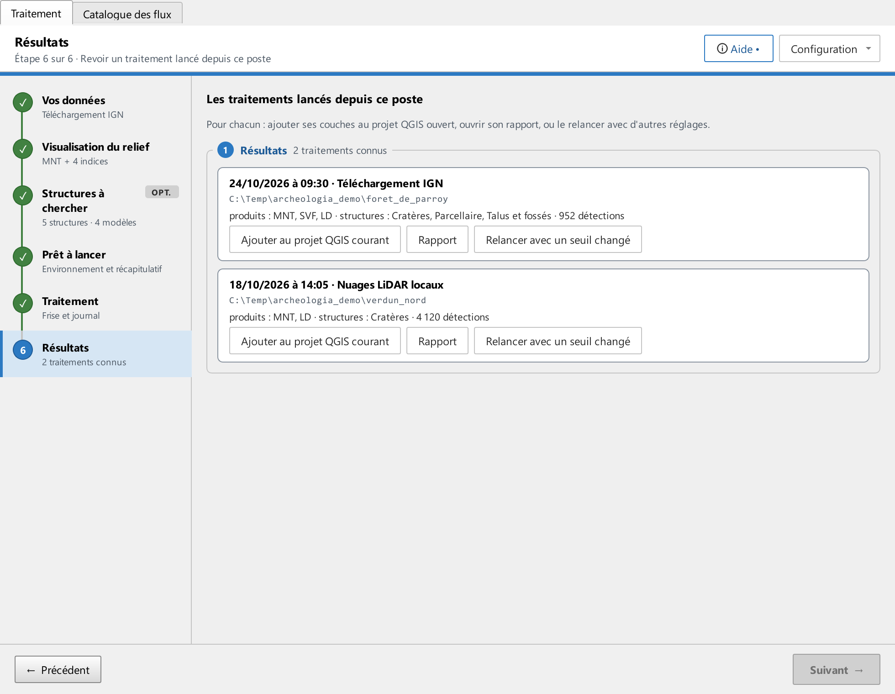

# Vos résultats dans QGIS

## Le dossier de sortie

Deux dossiers, une règle : `livrable/` se garde et se transmet, `technique/` se supprime. Le [schéma de la chaîne](premier-traitement.md#ce-que-fait-le-plugin) montre quelle phase écrit chaque dossier.

```
dossier_de_sortie/
├── livrable/                          ce que vous gardez et transmettez
│   ├── projet.qgs                     le projet QGIS stylé : le point d'entrée
│   ├── rapport.html                   le rapport, à ouvrir dans le navigateur
│   ├── traitement.json                résumé du traitement, sans chemin de votre poste
│   ├── indices/
│   │   ├── MNT/tif/                   le modèle de terrain, dalle par dalle
│   │   │   └── index_MNT.vrt          la mosaïque, chargée dans QGIS
│   │   └── SVF_R10_D16_V1_N0/tif/     un produit, avec ses réglages dans le nom
│   │       └── index_SVF.vrt
│   └── detections/
│       ├── parcellaire/parcellaire.gpkg   un GeoPackage par structure
│       └── parcellaire/fiabilite.json     les coupures de fiabilité de cette couche
└── technique/                         ce que vous pouvez supprimer
    ├── sources/dalles/                dalles LiDAR, re-téléchargeables ; à côté :
    │                                  une note « .verifie.json » (lue en entier)
    │                                  et « .partial » après une coupure
    ├── intermediaires/                fichiers de calcul par dalle
    ├── png/                           images préparées pour la détection
    ├── detection/<modèle>/            sorties brutes et images annotées
    └── journaux/                      un journal et une trace complète par lancement
```

Copier `livrable/` suffit à transmettre un traitement : le projet QGIS y retrouve ses couches par des chemins relatifs. Supprimer `technique/` libère la place ; un traitement relancé re-télécharge ou recalcule ce qui manque.

### Le nom d'un dossier de produit

Le dossier d'un produit porte ses réglages : `SVF_R10_D16_V1_N0` est un facteur de vue du ciel à rayon 10 pixels, 16 directions, exagération 1, sans suppression de bruit ; `LD_A15_Rmin10_Rmax20_H1p7_V1` une dominance locale avec ses rayons et sa hauteur d'observation. Les rayons du nom sont les **pixels** que le calcul a reçus, à la résolution du MNT : le réglage par défaut de 5 m donne `R10` à 0,5 m et `R5` à 1 m, et le rapport de traitement donne les deux, mètres et pixels. Une sortie flottante (« Sauver en 8 bits » décoché) ajoute `_F32` au nom : `SVF_R10_D16_V1_N0_F32`. Relancer avec d'autres réglages, ou en passant du 8 bits au flottant, crée un autre dossier au lieu d'écraser le premier. Le MNT, la densité et la couverture rangent leurs fichiers dans un dossier au nom seul ; le nom de chaque MNT porte sa résolution (`…_MNT_A_0M50_…` à 0,5 m, `…_MNT_A_1M00_…` à 1 m), celle du MNT fourni en point de départ MNT existant. Relancer à une autre résolution dans le même dossier remplace le MNT de chaque dalle : la mosaïque ne mélange jamais deux résolutions. En point de départ Indices de visualisation existants, tout va sous `livrable/indices/RVT/`.

Dans chaque dossier `tif/`, la mosaïque `index_<PRODUIT>.vrt` assemble toutes les dalles : c'est elle que QGIS charge, sous le nom du produit comme à l'étape 2, les réglages du dossier à la suite : « MNT · Relief nu », « SVF · Creux & dépressions · R10_D16_V1_N0 ». Chargée à la main, elle garde son nom de fichier, reconnaissable.

## Le projet de validation

`livrable/projet.qgs` est écrit à la fin de chaque traitement et constitue le point d'entrée pour valider les détections. Tout y est réuni dans un groupe au [nom de l'analyse](etape-1-source.md#nom-de-l-analyse), suivi de la date et de l'heure du traitement : « be_vl · indices — 01/11/2026 14:05 ». Le projet porte ce même titre (menu Projet ▸ Propriétés) ; il ne garde pas le nom de l'utilisateur du poste qui l'a écrit, pour être transmis tel quel. Dans ce groupe, de haut en bas : la couche des zones mal couvertes quand la couverture a été calculée, un groupe **Structures**, puis un groupe **Indices** avec les mosaïques des produits, nommées comme à l'étape 2, le modèle de terrain en dernier. Le groupe **Structures** a une couche de détections stylée par structure, nommée comme elle : « Cratères », « Parcellaire ». Une structure détectée en plusieurs classes a une couche par classe, « Talus et fossés · talus » ; un regroupement forme un sous-groupe avec ses zones et les détections qui les composent ; deux modèles comparés sur une même structure donnent deux couches, « Parcellaire — Modèle A » et « Parcellaire — Modèle B », dans un sous-groupe marqué « comparaison ». La couleur d'une couche est celle de sa structure, la même à l'étape 3, dans la légende et dans le rapport, et elle ne change pas d'un traitement à l'autre.

Les mêmes couches, dans le même groupe, sont chargées dans votre projet QGIS courant quand vous cliquez **Ajouter au projet QGIS courant** à la fin du traitement, une seule fois. Rien ne se charge sans ce clic ; le fichier `livrable/projet.qgs` s'ouvre comme tout projet QGIS, depuis le menu Projet ou l'explorateur de fichiers.

Chaque traitement ajouté a son groupe, en haut du panneau des couches : deux analyses chargées côte à côte ne se mélangent pas. Ajouter de nouveau le même traitement, depuis l'étape **Résultats**, ne duplique rien : ses couches et son groupe sont repris, même si vous avez renommé le groupe. Au lancement d'un nouveau traitement dans le même dossier de sortie, les couches du précédent sont retirées du projet, et son groupe avec elles une fois vide ; vos propres groupes ne sont jamais touchés.

## Revoir un résultat

La sixième étape de l'assistant, **Résultats**, liste les traitements lancés depuis ce poste, du plus récent au plus ancien : la date, le point de départ, le dossier, les produits, les structures et le nombre de détections. Pour chacun, **Ajouter au projet QGIS courant** charge ses couches, stylées, dans le projet ouvert ; **Rapport** ouvre son rapport ; **Relancer avec un seuil changé** recharge ses réglages dans l'assistant et l'ouvre à l'étape 3, pour modifier un seuil et relancer dans le même dossier. Un dossier déplacé ou supprimé disparaît de la liste ; un traitement d'une version précédente, sans trace complète, se consulte mais ne se relance pas d'ici.

[](img/etape6-resultats.png)

## La légende de fiabilité

Chaque couche de détections est catégorisée en quatre niveaux : **douteux**, **possible**, **probable**, **très probable**. Un niveau est défini par la part de vrais objets mesurée à l'évaluation du modèle dans la bande de scores correspondante : au moins 35 % pour possible, 60 % pour probable, 85 % pour très probable. Le mot veut donc dire la même chose pour tous les modèles ; seuls les scores de coupure changent.

Le dessin : contour seul, sans remplissage, pour laisser lire la structure détectée dessous ; une couleur par classe, déclinée du plus foncé (très probable) au plus clair (douteux). L'infobulle de la couche et son résumé, dans les propriétés, donnent la part mesurée pour chaque niveau et le nombre de détections sur lequel elle a été mesurée.

À l'ouverture, seuls **très probable** et **probable** sont cochés dans la légende ; **possible** et **douteux** y sont, décochés. Pour le parcellaire, **possible** est coché d'emblée. Commencez par ce qui est sûr, puis cochez les deux autres niveaux d'un clic dans le panneau des couches pour élargir : toutes les détections sont dans le GeoPackage, dans le bilan de fin de traitement et dans le rapport. L'état des cases est enregistré dans le projet ; une couche chargée depuis le bouton « Ajouter au projet QGIS courant » s'ouvre de la même façon.

Quand vous avez baissé le seuil d'une structure sous celui du modèle, les détections ajoutées forment le niveau **douteux · sous le seuil du modèle** : la part de vrais y est celle mesurée pour cet intervalle quand le modèle la fournit, sinon « non mesurée » ; les autres niveaux gardent leurs coupures. Ces détections sont fusionnées entre elles, jamais avec celles qui passaient déjà le seuil : un bon polygone n'est pas tiré vers le bas par un fragment faible accolé. L'infobulle d'une détection dit, pour un polygone fusionné, de combien de fragments il est fait et le score du plus sûr.

[](img/resultats-legende-fiabilite.jpg)

Pour voir d'où viennent les coupures d'une classe, ouvrez sa fiche à l'étape 3 : le **profil des scores** range les détections de l'évaluation par score, vraies en couleur et fausses en gris, et trace les coupures. Sous le seuil, presque tout est faux ; au-dessus de la dernière coupure, presque tout est vrai.

Une couche issue d'un modèle sans fiabilité mesurée est catégorisée par tranches de score.

## Le contexte moderne

Quand l'option « Signaler le contexte moderne » de l'étape 4 est cochée, chaque détection est comparée, à la fin du traitement, à des données de la BD TOPO de l'IGN : les bâtiments et les surfaces en eau pour toutes les structures, et, pour les structures ponctuelles (charbonnières, fours, cratères, dépressions, enclos), les zones d'habitation, les ronds-points et les cours d'eau. Les zones de regroupement de cratères ne sont pas comparées. Si le service de l'IGN ne répond pas, chaque page est redemandée deux fois avant d'y renoncer. Rien n'est supprimé : une détection posée sur un objet moderne change seulement de catégorie dans la légende.

Une catégorie grise s'ajoute aux niveaux de fiabilité : **Contexte moderne**, contour gris en pointillés, **décochée** à l'ouverture comme possible et douteux. Elle reçoit les détections dont les bâtiments recouvrent ensemble au moins 10 % de la surface, celles dont un plan d'eau aménagé (retenue, réservoir, bassin, canal, plan d'eau de gravière) recouvre au moins 10 %, et, pour les structures ponctuelles, celles dont la moitié au moins est sur un rond-point. Cochez-la pour les revoir. Au survol d'une détection grisée, l'infobulle dit pourquoi (« plan d'eau de gravière recouvrant 35 % de la détection ») et d'après quelle donnée ; une simple information, sans effet sur la légende, y apparaît aussi, précédée de « À noter ».

La règle dépend de la structure détectée :

| Structure | Ce qui la grise |
|---|---|
| Enclos, enclos circulaires | des bâtiments qui recouvrent au moins 10 % de la détection, un plan d'eau aménagé qui en recouvre au moins 10 %, un rond-point |
| Grandes dépressions | des bâtiments qui recouvrent au moins 10 % de la détection, un rond-point. Un étang ne fait qu'informer : la cuvette peut l'avoir précédé |
| Charbonnières, fours, cratères | des bâtiments qui recouvrent au moins 10 % de la détection, un plan d'eau aménagé qui en recouvre au moins 10 %, un rond-point |
| Talus, fossés, chemins creux, parcellaires, tranchées | **rien** : une structure linéaire longe et traverse le bâti et l'eau sans en être un leurre. Leur légende n'a pas de catégorie grise ; les bâtiments et l'eau se lisent dans `contexte_info` |

Leur niveau de fiabilité ne change pas : il reste dans le champ `fiabilite`, dans le bilan et dans le rapport.

Certains objets informent sans griser la détection, parce qu'ils ne disent pas qu'elle est un leurre :

- un **bâtiment** à moins de 5 m, ou des bâtiments qui recouvrent moins de 10 % de la détection ; de même un **plan d'eau aménagé** qui en recouvre moins de 10 % : à côté, il ne dit pas qu'elle est un leurre ;
- une **zone d'habitation** qui touche ou contient la détection : c'est le bâtiment qui grise, jamais la zone ;
- une **mare** à moins de 15 m : sous une dépression, ce peut être une mardelle ;
- une **retenue** sous un talus ou un fossé : une digue d'étang est un vrai talus, parfois ancien ;
- un bâtiment **en ruine**, une **église**, une **chapelle**, un **château**, une **tour** : c'est du patrimoine, pas du contexte moderne ;
- une surface en eau d'**origine naturelle** ;
- un **cours d'eau** qui traverse la détection ou passe à moins de 15 m ;
- des **ruines**, un **moulin** ou un **château** nommés par l'IGN parmi les zones d'habitation ;
- un rond-point qui ne recouvre qu'une **partie** de la détection, moins de la moitié.

Les zones d'habitation et ces quatre dernières lignes ne concernent que les structures ponctuelles ; les talus, fossés, chemins creux, parcellaires et tranchées ne sont comparés qu'aux bâtiments et à l'eau.

L'information se lit dans les attributs de la détection, en une phrase : « mare à 6 m (origine naturelle) ». Quand plusieurs données ont quelque chose à dire, chacune donne sa phrase, la plus proche d'abord, séparées par un point-virgule : « dans la zone d'habitation « Hameau du Ruisseau » ; bâtiment résidentiel à 3 m ». La phrase donne le nom courant de l'objet, puis le mot de l'IGN entre parenthèses quand il diffère : l'IGN appelle « retenue » tout plan d'eau artificiel retenu par une digue, étangs compris. Le journal de fin de traitement donne le nombre de détections grisées et informées. Sans connexion à internet, ou hors de France, le croisement n'est pas fait et le journal le dit ; le traitement n'échoue jamais pour cela.

Pour voir l'objet qui a grisé ou informé une détection, lisez son attribut `contexte_source` : il nomme la donnée telle qu'elle s'appelle dans le Catalogue des flux, section « Données vectorielles » (Bâtiments, Zones d'habitation, Surfaces en eau et mares, Cours d'eau, Ronds-points). Ajoutez-la au projet : ses contours se posent sur le relief. Plus direct : le bouton **Ajouter le contexte moderne** de la fin du traitement ajoute d'un coup ces cinq données, telles qu'elles ont été lues pour le croisement. Elles sont enregistrées dans `livrable/contexte/contexte_moderne.gpkg` : le dossier transmis à un collègue montre les mêmes objets, sans connexion à internet.

## Les attributs d'une détection

| Attribut | Contenu |
|---|---|
| `model_pred` | la classe prédite par le modèle |
| `confidence` | le score du modèle, entre 0 et 1 |
| `fiabilite` | le niveau de fiabilité affiché dans la légende |
| `fiabilite_pct` | la part de vrais objets mesurée pour ce niveau, en pour cent |
| `conf_bin` | la tranche de score, pour les modèles sans fiabilité mesurée |
| `n_membres` | le nombre de fragments fusionnés dans ce polygone (1 : détection isolée) |
| `conf_max` | le score du fragment le plus sûr ; `confidence` est la moyenne pondérée par l'aire |
| `longueur_m` | la longueur du polygone, en mètres (celle d'un rectangle de même aire et de même périmètre : la longueur d'un tracé, sans sens particulier pour une forme trapue) |
| `model_name` | le modèle qui a produit la détection |
| `cluster_id` | le regroupement auquel la détection appartient, le cas échéant |
| `contexte_moderne` | ce qui grise la détection : « bâtiment agricole recouvrant 25 % de la détection », « étang (retenue) recouvrant 80 % de la détection », « sur un rond-point » ; plusieurs motifs séparés par un point-virgule ; vide sinon |
| `contexte_info` | ce qui informe sans griser : « mare à 6 m (origine naturelle) », « bâtiment résidentiel à 3 m », « dans la zone d'habitation « … » », « cours d'eau traversant la détection » ; plusieurs motifs séparés par un point-virgule ; vide sinon |
| `contexte_dist_m` | la distance, en mètres, à l'objet du premier motif (celui qui grise, sinon celui qui informe) |
| `contexte_part` | la part de la détection que cet objet recouvre, en pour cent |
| `contexte_source` | les données citées, sous leur nom dans le Catalogue des flux (« Bâtiments · Cours d'eau »), leur base et leur date de lecture ; remplie même quand rien n'a été trouvé, avec les données consultées |
| `aussi_vu_comme` | l'autre structure sous laquelle le même objet a été détecté, avec son niveau de fiabilité : « Charbonnières (probable, 68 %) » ; vide quand l'objet n'est vu qu'une fois |
| `corr_pred`, `validation` | deux champs vides, à votre usage pour corriger la classe et noter votre verdict |

Deux modèles peuvent détecter le même objet sous deux structures différentes : une charbonnière se retrouve aussi parmi les dépressions circulaires grandes. Les deux détections sont gardées, et chacune nomme l'autre dans `aussi_vu_comme`. Aucune n'est écartée d'office : la plus fiable des deux n'est pas toujours la bonne. Pour les revoir ensemble, filtrez la couche par l'expression `"aussi_vu_comme" IS NOT NULL`.

Les zones issues d'un regroupement portent en plus le nombre de détections qu'elles contiennent, leur surface en mètres carrés, leur densité par hectare, le score que dépassent les 10 % de détections les mieux notées (`conf_p90`) et l'élongation médiane des détections (`elong_med`).

## Valider les détections

Ouvrez le projet de validation, parcourez une couche de détections avec l'indice sur lequel le modèle a travaillé en dessous, et renseignez `validation` au fil de l'eau avec l'un des trois verdicts du formulaire : **oui** (vrai objet), **non** (fausse détection), **peut-être** (à revoir). Si la classe réelle est une autre, notez-la dans `corr_pred`. Ces verdicts servent ensuite : la fiche d'une classe (étape 3) affiche, à côté de la part de vrais objets mesurée au banc, la part observée **chez vous**, niveau par niveau, sur les traitements lancés depuis ce poste. Les détections **douteux** valent le coup d'œil mais rarement plus : en prospection, une fausse détection s'écarte en quelques secondes, une structure manquée ne se rattrape pas, c'est pourquoi le seuil par défaut laisse passer cette catégorie.

Pour une dalle, les détections de toutes les structures se superposent sans doublon aux bords : chaque dalle ne rapporte que les objets dont le centre est chez elle.

## Les traces d'un traitement

`livrable/traitement.json` résume le dernier traitement : version du plugin, date, nombre de dalles, système de coordonnées de toutes les couches (celui des données d'entrée, jamais reprojeté), version de PDAL qui a calculé le MNT et méthode de fusion des nuages, produits et leurs réglages, modèles lancés avec l'appareil qui a détecté (processeur ou carte graphique, et son nom), structures produites avec le chemin de leur GeoPackage, le bilan de fiabilité par structure, le moteur de détection employé ou, si la détection a été impossible, sa cause. Il ne porte aucun chemin de votre poste et se transmet avec le livrable.

`technique/journaux/` garde, pour chaque lancement, le journal détaillé `pipeline_log_<date>.txt` et la trace complète `metadata_<date>.json`, avec la configuration entière de l'assistant, chemins de votre poste compris. C'est ce qu'il faut joindre à une demande d'aide.

## Un MNT reproductible

La fusion de chaque dalle avec ses voisines lit les points toujours dans le même ordre : deux traitements des mêmes dalles avec la même version de PDAL, celle que note `livrable/traitement.json`, donnent le même MNT au bit près. Un dossier calculé par une version précédente du plugin voit donc son MNT, et tout ce qui en découle (images, détections), recalculé une dernière fois à la relance : le journal le signale par « Méthode de calcul mise à jour ». L'écart avec l'ancien MNT est de l'ordre de celui qu'il y avait déjà entre deux traitements identiques.

Dans les points de départ LiDAR (téléchargement IGN, LAZ local), la grille du MNT, de la densité et de la couverture est calée sur celle des dalles IGN (bords des pixels sur les multiples de la résolution) : chaque pixel publié est un pixel calculé, recadré sans rééchantillonnage, au même endroit d'un traitement à l'autre. Les MNT et densités calculés par une version précédente pouvaient être décalés d'un demi-pixel (25 cm pour un MNT à 0,5 m), dans un sens qui variait d'une dalle et d'une relance à l'autre ; la relance d'un tel dossier refait une fois sa fusion, ses MNT, sa densité et ses images (« Méthode de calcul mise à jour »). Le calage ne concerne pas un MNT fourni (point de départ MNT existant) : s'il n'est pas déjà sur les multiples de sa résolution, son recadrage au kilomètre le rééchantillonne.

## Faire de la place

Une fois le traitement validé, supprimez `technique/` : rien du livrable n'en dépend. Si vous voulez garder les nuages de points téléchargés, déplacez d'abord `technique/sources/`. Un traitement relancé dans le même dossier re-télécharge ou recalcule ce qui manque.

Sur Windows, un dossier de sortie très profond peut dépasser la limite de 260 caractères d'un chemin : choisissez un dossier de sortie court.

## Un dossier d'une version précédente

Un dossier de sortie écrit avant cette organisation garde ses anciens dossiers à la racine : `indices/`, `detections/`, `intermediaires/`, `sources/`, les journaux et `metadata.json`. Au lancement d'un traitement dans ce dossier, le plugin propose de le réorganiser et attend votre accord : il montre ce qui sera déplacé, déplace sans copier, et retire du projet QGIS les couches chargées depuis les anciens emplacements, rechargées en fin de traitement. Ce qu'il ne reconnaît pas, par exemple un dossier que vous avez posé vous-même, ne bouge pas et vous est indiqué. Refusez, et le traitement n'est pas lancé : choisissez alors un autre dossier de sortie.

Certains dossiers de produits d'une version précédente ne sont plus ceux que le plugin écrit : une sortie flottante sans `_F32` dans son nom, une pente « Pourcentage » sous `SLO_U1…` (qui donnait des radians), un MSTP à l'échelle large de rvt (`…_B223-2023…`), un M-HS 8 bits avec un autre nombre de directions que 16 dans son nom. Le plugin les laisse en place et écrit le nouveau dossier à côté ; le projet QGIS du traitement charge le nouveau. Supprimez les anciens à la main si vous n'en avez plus l'usage.
