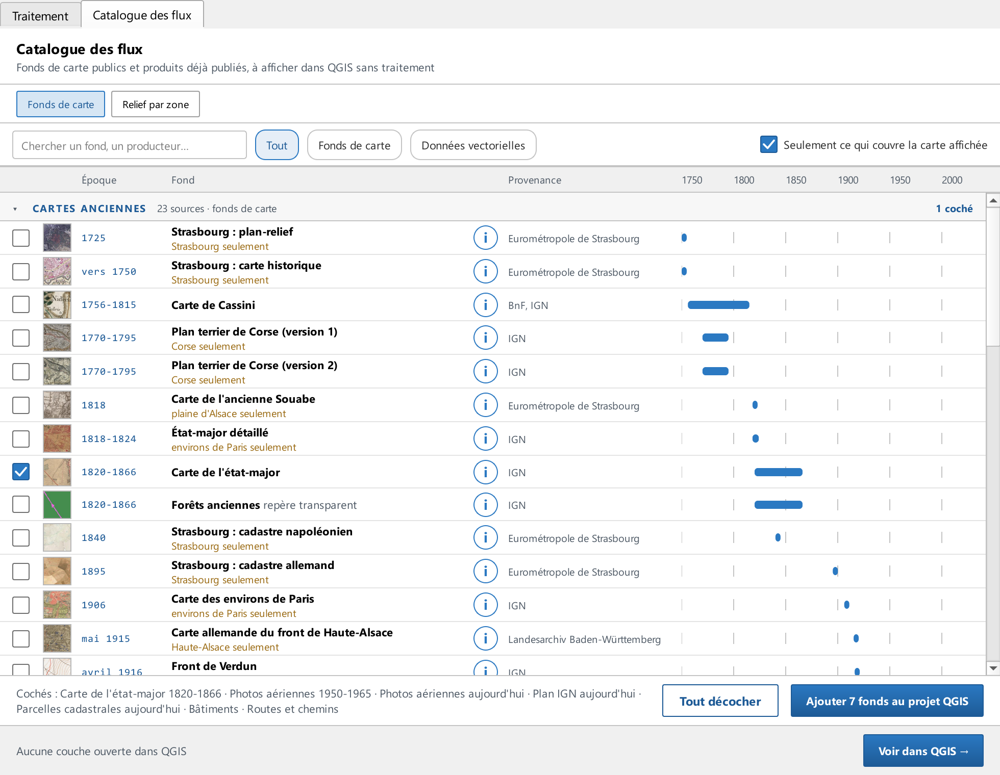
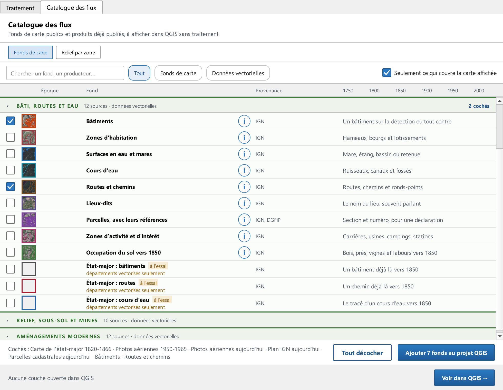
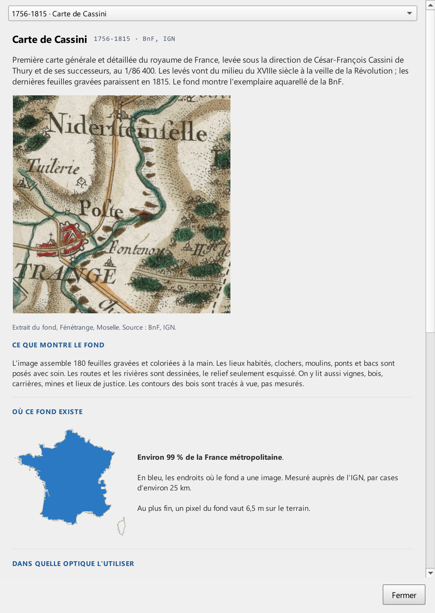
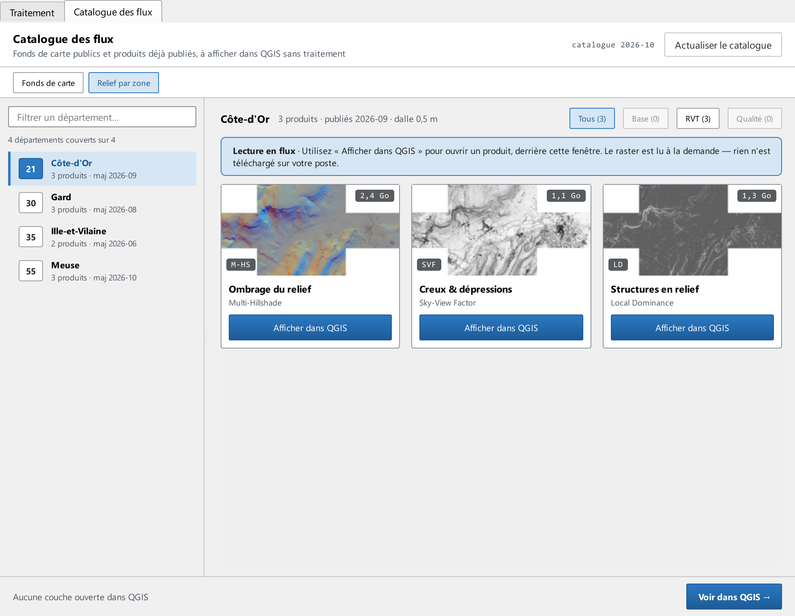

# Catalogue des flux

Le second onglet de la fenêtre, à côté de **Traitement**, ouvre dans QGIS des images déjà prêtes, sans rien calculer ni télécharger. Il a deux pages, choisies par les deux boutons du haut. **Fonds de carte** propose les cartes anciennes et les photos aériennes publiques, les mêmes partout en France. **Relief par zone** propose les produits déjà publiés par votre organisation, département par département. Cette seconde page n'existe que sur un poste où un catalogue de ces flux est installé ; sans lui, l'onglet ne montre que les fonds de carte.

## Les fonds de carte

Chaque ligne est un fond public, servi sans compte ni clé, le plus souvent par l'IGN : la carte de Cassini, la carte de l'état-major, la carte de 1950, les photos aériennes de chaque période depuis 1950, le Plan IGN, les cartes géologiques, le relief LiDAR HD ombré de l'IGN, l'occupation du sol. S'y ajoutent des fonds propres à une région : les cartes du front de Verdun, le plan terrier de Corse, les plans, cadastres et photos anciennes de Strasbourg, les cartes militaires allemandes d'Alsace et des Vosges, les photos anciennes du Calvados. La barre bleue situe l'époque du fond sur un axe commun, de 1750 à aujourd'hui : on y lit d'un coup d'œil ce qui existe pour une période. La colonne **Provenance** nomme qui produit la donnée (IGN, BRGM, BnF, DGFiP, SHOM, INRAP, Eurométropole de Strasbourg, Landesarchiv Baden-Württemberg, ministère de la Culture), en entier. L'infobulle du titre donne la source et la finesse du fond ; le bouton **i** ouvre sa fiche.

La page est rangée par **thèmes**, que l'on déplie ou replie d'un clic sur leur bandeau : d'abord les fonds de carte (cartes anciennes, photos aériennes, relief, sol et géologie), puis les données vectorielles sur fond vert (archéologie connue et patrimoine, bâti, routes et eau, relief, sous-sol et mines, aménagements modernes). Chaque bandeau dit combien de sources il contient et combien sont cochées ; les deux premiers sont dépliés à l'ouverture. Une donnée vectorielle n'a pas de barre sur l'axe du temps : à la place, une phrase dit ce qu'on y lit.

L'étiquette **à l'essai** marque une donnée vectorielle repérée récemment, qui n'a pas encore de fiche ni de vignette : elle s'ajoute au projet comme les autres, et c'est en l'essayant qu'on décide de la garder. Tous les fonds de carte, eux, ont leur fiche. Plusieurs viennent d'un autre service que celui de l'IGN (BRGM, Géorisques, DRAC de Bretagne, plateformes régionales) ; la colonne **Provenance** le dit.

En haut de la page, le champ de **recherche** filtre par mot (« carrière », « BRGM », « 1950 ») et déplie les thèmes concernés ; les trois boutons limitent la liste aux fonds de carte ou aux données vectorielles.

Beaucoup de sources ne valent que pour une région, dite sous leur titre (« Bretagne seulement »). La case **Seulement ce qui couvre la carte affichée**, cochée d'office, met de côté celles qui ne touchent pas la carte ouverte dans QGIS ; une ligne en bas de la liste dit combien, et un clic dessus les montre. Sur un projet vide, rien n'est mis de côté.

En bas, à côté du bouton d'ajout, la page nomme ce qui est coché, même dans un thème replié. **Tout décocher** repart de zéro d'un geste, thèmes repliés compris ; il ne retire rien du projet QGIS.

Beaucoup de fonds sont locaux et le disent sur leur ligne : les cartes du front de Verdun n'existent que dans la Meuse, l'état-major détaillé qu'autour de Paris, le plan terrier qu'en Corse, les plans et cadastres anciens qu'à Strasbourg. D'autres sont incomplets : les photos aériennes des années 1980 à 1995 ne couvrent qu'une partie du pays, et un fond coché peut donc rester vide à l'endroit que vous regardez : la carte de sa fiche dit où il existe.

Quatre fonds sont des **repères transparents**, les parcelles cadastrales, les forêts anciennes, les courbes de niveau et la sélection de fouilles de l'INRAP : ils se posent par-dessus n'importe quel autre fond.

## Les données vectorielles

Sous les fonds de carte, une seconde section, sur fond vert, rassemble les **données vectorielles**. Ce ne sont pas des images mais des objets de l'IGN, du ministère de la Culture, des services régionaux de l'archéologie ou des communes, dessinés en contours fins par-dessus le relief, sans le cacher. La vignette de chaque ligne est bordée de la couleur de ses contours.

| Objets | Ce que donne le clic |
|---|---|
| Bâtiments | la nature : « agricole », « église », « en ruine »… |
| Zones d'habitation | la nature et le nom : « Lieu-dit habité · Hameau du Ruisseau », « Ruines », « Moulin »… |
| Surfaces en eau et mares | la nature : « mare », « retenue », « réservoir-bassin »… |
| Cours d'eau | la nature, le nom et la persistance : « Ecoulement naturel · la Semouse · permanent » |
| Routes et chemins | la nature : « chemin », « sentier », « route empierrée »… |
| Lieux-dits | le nom du lieu, écrit aussi à côté de son point |
| Parcelles, avec leurs références | « Section 06 · parcelle 56 · commune » |
| Zones d'activité et d'intérêt | « Camp militaire non clos », « Carrière », « Vestige archéologique »… |
| Monuments historiques | le nom du monument classé ou inscrit |
| Occupation du sol vers 1850 | « Prairie », « Forêt », « Cultures », « Étang, lac »… |
| Archéologie des PLU, zones et points | le libellé que la commune a donné au site ou au périmètre : « Périmètre archéologique », « Sites archéologiques recensés »… |
| Sites archéologiques connus (Bretagne) | la nature, la période et le lieu-dit : « enclos · Âge du fer · … » |
| Zones de présomption (Bretagne, Centre-Val de Loire, Auvergne-Rhône-Alpes) | la commune, la zone, et selon la région l'arrêté, le seuil ou le motif scientifique |
| Opérations archéologiques (Bretagne) | la nature de l'opération, son année et son titre : « diagnostic 2012 · … » |
| Réseau viaire ancien (Bretagne) | le nom de la voie et sa période |
| Monuments historiques, notices (Bretagne, Hauts-de-France) | le titre de la notice, et en Bretagne le siècle et la protection |
| Sites inscrits et classés | « Site classé » ou « Site inscrit », puis son nom |
| Sites patrimoniaux remarquables | le nom du site |

Le clic se fait avec l'outil d'identification de QGIS ; le survol d'un objet donne la même phrase. QGIS ne charge que les objets de la zone affichée, et rien en vue large : zoomez à l'échelle d'une commune ou plus près pour les voir. Les monuments historiques ne sont pas en ligne pour toutes les communes : une absence de contour ne prouve pas l'absence de monument.

Le thème **Archéologie connue et patrimoine** rassemble ce qui est déjà connu ou protégé là où vous lisez une anomalie du relief. Ces données sont très inégales selon les territoires : l'archéologie des plans locaux d'urbanisme n'existe que dans les communes qui l'ont reportée dans leur plan, surtout dans l'Ouest ; les sites connus, les opérations et les voies anciennes ne sont diffusés que pour la Bretagne ; les zones de présomption que pour trois régions. La carte de France de chaque fiche montre où la donnée existe : regardez-la avant de conclure qu'il n'y a rien, car l'absence de contour ne dit pas l'absence de vestige.

## La fiche d'un fond

Le bouton **i** d'une ligne ouvre la fiche du fond dans une fenêtre à part, que vous pouvez garder ouverte en cochant. Elle se lit comme la fiche d'un produit ou d'une structure : un extrait du fond, ce qu'il montre, dans quelle optique s'en servir, ce qu'il ne montre pas, comment il a été fait, et ses sources, cliquables. La liste en tête de fenêtre passe d'un fond à l'autre.

La carte de France de la fiche montre en bleu **où le fond a réellement une image**. Elle a été mesurée auprès du service qui diffuse le fond, par cases d'environ 25 km : la carte de Cassini s'arrête avant la Corse, les photos aériennes des années 1980 à 1995 ne couvrent qu'une partie du pays, la carte du front de Verdun tient en un point. Regardez-la avant d'ajouter un fond incomplet.

## Ajouter les fonds au projet

Aucun fond n'est coché au départ. Cochez ceux que vous voulez, puis **Ajouter N fonds au projet QGIS**. Ils arrivent **décochés** : la carte ne change pas tant que vous n'en choisissez pas un, et la page vous le rappelle.

La suite se passe dans l'arbre des couches de QGIS. Les fonds y sont rangés dans un groupe **Fonds de carte**, du plus ancien au plus récent, chacun nommé par son époque. Ce groupe ne montre qu'**un fond à la fois** : cocher une autre époque décoche la précédente. Vous remontez ainsi le temps sous une détection en un clic, sans revenir à l'assistant. Décochez le fond visible pour retrouver le relief.

Douze fonds portent leur légende officielle, repliée sous la couche : dépliez la couche dans l'arbre pour la lire. Les autres, des photos, des ombrages et des cartes scannées, n'en ont pas.

Le groupe se place au-dessus des images du relief et sous le groupe **Structures** : un fond coché recouvre le relief, les contours des détections restent visibles par-dessus. Les repères transparents vont dans un groupe **Repères**, juste au-dessus, et les données vectorielles dans un groupe **Données vectorielles**, au-dessus encore : dans ces deux groupes, les couches se cochent librement, plusieurs à la fois.

Un second clic sur le bouton n'ajoute pas deux fois le même fond. Les fonds restent dans le projet enregistré. Hors de France, un fond n'affiche rien.

## Le relief par zone

Cette page affiche des produits déjà publiés par votre organisation : vous choisissez un département, un produit, et il s'ouvre dans QGIS, lu à la demande. C'est le chemin le plus court quand la zone qui vous intéresse a déjà été traitée et publiée. Elle s'ouvre en premier quand un catalogue est installé ; sinon l'onglet s'ouvre sur les fonds de carte.

Ce que la page montre vient d'un **catalogue** installé avec le plugin par votre organisation : la liste des départements publiés et, pour chacun, les produits disponibles avec leur date de publication, leur résolution et leur poids. Le plugin seul n'en contient pas. En haut à droite, la date du catalogue ; **Actualiser le catalogue** le relit, après une mise à jour par votre organisation.

Sans catalogue sur le poste, la page le dit : « Aucun catalogue n'est installé sur ce poste : cette page sert aux flux publiés par votre organisation », avec un lien vers ce chapitre. Ce n'est pas une panne. Un catalogue présent mais illisible est signalé avec son emplacement.

## Choisir un département

La colonne de gauche liste les **départements couverts**, avec le nombre de produits de chacun ; le compte « N départements couverts sur M » rappelle l'étendue de la publication. Le champ **Filtrer un département…** réduit la liste au nom ou au numéro tapé. À l'ouverture, le département mis en avant par le catalogue est sélectionné, pour que le mur soit plein tout de suite.

## Le mur de produits

À droite, le mur du département choisi : son nom, le nombre de produits et leur date de publication, puis une carte par produit, avec sa vignette, son sigle, son titre tel qu'à l'étape 2 (« Creux & dépressions »), son nom technique et son poids. Les boutons **Tous**, **Base**, **RVT** et **Qualité** filtrent par famille : le relief nu, les indices de visualisation, les cartes de qualité de la donnée.

Le bandeau au-dessus des cartes dit ce que fera le clic : en **lecture en flux**, le raster est lu à la demande et rien n'est téléchargé sur votre poste ; en **aperçu local**, le catalogue lit des rasters déjà calculés sur ce poste.

## Afficher dans QGIS

Le bouton **Afficher dans QGIS** d'une carte ouvre le produit dans votre projet QGIS courant, derrière l'assistant, sous le nom « <sigle> — <département> ». Pendant l'ouverture, la carte l'indique ; une fois la couche ouverte, la carte prend un cadre. Un clic sur une carte ouverte, ou sur sa croix, **retire la couche de QGIS**. Retirer la couche depuis le panneau des couches de QGIS remet la carte dans son état initial : les deux restent d'accord.

En bas, **Tout retirer** retire les couches ouvertes par cet onglet, fonds de carte compris, et seulement elles : vos autres couches ne sont jamais touchées. **Voir dans QGIS →** masque l'assistant pour laisser voir la carte : une barrette « Archéolog'IA » reste en haut à droite de QGIS, et un clic sur elle ou sur l'icône du plugin le rouvre tel qu'il était. Le titre de l'onglet porte le nombre de couches ouvertes, « Catalogue des flux (3) ».

Si un produit ne s'ouvre pas, le message de QGIS en donne la raison : le flux est injoignable ou l'adresse a changé ; signalez-le à qui publie le catalogue.
